# Inkflow

An infinite canvas for Android tablets that mixes handwriting with real diagrams. You can write
with the S Pen, then switch to flowcharts, UML or database models on the same board, and export
the result as images, PDF or code (SQL, PlantUML, Mermaid).

Inkflow is built for the **Galaxy Tab S9 FE+ and its S Pen**, and runs on any Android 10+ tablet
or phone. It works **fully offline**: it has no network permission, and projects only leave the
device when you export them.

**Download:** get the APK from the [latest release](https://github.com/Leonardo-Sponton/inkflow/releases/latest)
(Android 10 or newer). You will need to allow installing apps from your browser or file manager.

| Light | Dark |
|---|---|
| 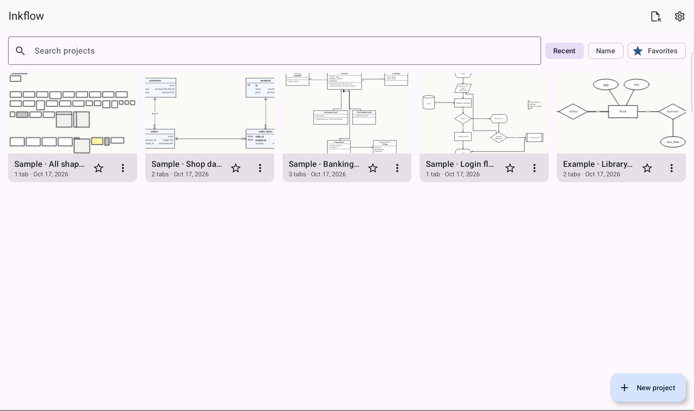 | 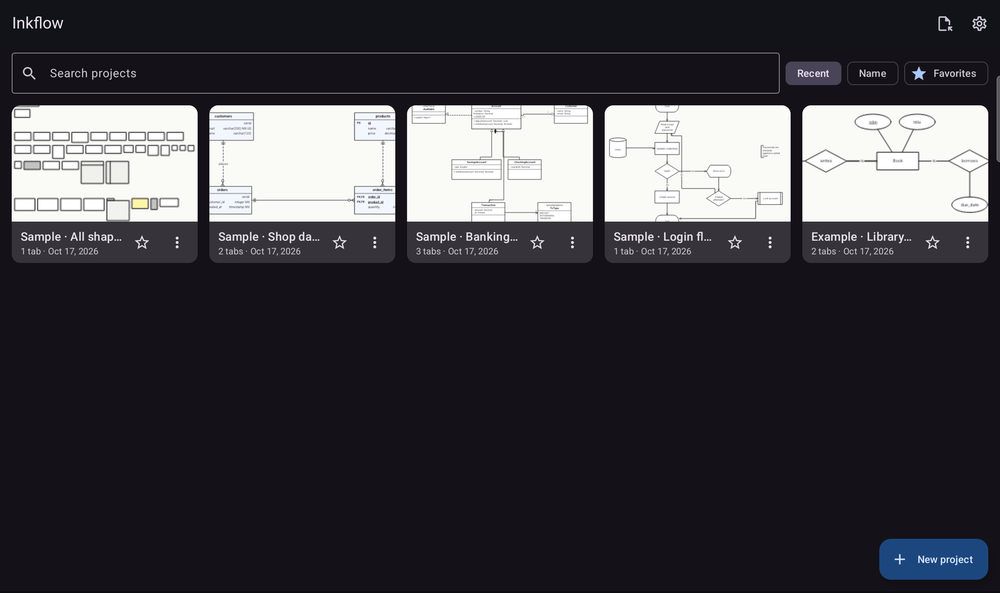 |

## Features

- **Infinite canvas:** smooth pan and pinch-zoom from 2 % to 4000 %, with dot, square or
  isometric grids, a minimap and fit-to-content. Large boards stay fluid: a 5 000-element board
  pans with a median frame time of about 8 ms on the target tablet.
- **Ink:**
  - Low-latency pressure-sensitive strokes (Jetpack Ink) with motion prediction and palm
    rejection.
  - Pen, pencil and highlighter brushes.
  - Stroke and partial erasers, plus the S Pen side button as an eraser or lasso.
  - Lasso selection that you can move, resize and undo.
  - Ink-to-shape: hold the pen still at the end of a stroke to snap it to a clean shape.
- **Diagram engine:**
  - Shapes with ports, and connectors that stay attached.
  - Straight, orthogonal (obstacle-avoiding) or curved routing.
  - Labels, containers, snapping and smart guides.
  - Quick-connect arrows, a searchable shape palette with drag and drop, and a properties panel.
- **Notations:**
  - **Flowchart:** the full ISO 5807 symbol set, swimlanes and Yes/No branches.
  - **UML:** class, use case, sequence, activity, state, component and deployment diagrams, with
    classes edited as structured data and 14 relation kinds.
  - **Database:** Chen ER diagrams (entities, relationships, attributes, cardinality) and
    Crow's Foot tables with typed columns, keys, indexes and automatic foreign keys.
  - **Validation** that flags structural mistakes in each notation.
- **Projects and tabs:**
  - A home gallery with thumbnails, search, sorting and favorites.
  - Several tabs per project, which you can reorder, rename and color.
  - Autosave, and an undo history that is kept between sessions.
- **Export and import:**
  - PNG (1–4×, optionally transparent), PDF and SVG.
  - **SQL DDL** for PostgreSQL, MySQL and SQLite, plus PlantUML and Mermaid `erDiagram`.
  - A `.inkflow` project archive, which can be imported again.
  - SQL DDL import, which turns an existing schema into tables.
  - Exports can be saved through the system file picker or sent with the share sheet.
- **Keyboard (Book Cover or Bluetooth):** undo/redo, clipboard, duplicate, group, zoom and
  one-key tool switching.
- **Accessibility:** TalkBack can announce and select canvas elements. Light and dark themes,
  a dark canvas and optional dynamic color are available.

## Example: from an ER model to SQL

The [`examples/`](examples) folder contains a small library database. It is modeled twice in the
same project, with both tabs drawn in the app:

1. **Conceptual (Chen):** authors *write* books, and members *borrow* books.
2. **Tables (Crow's Foot):** the same model as tables. `book_authors` resolves the M:N
   relationship, and `loans` records each borrowing with its `due_date`.

| | Light | Dark |
|---|---|---|
| Conceptual | 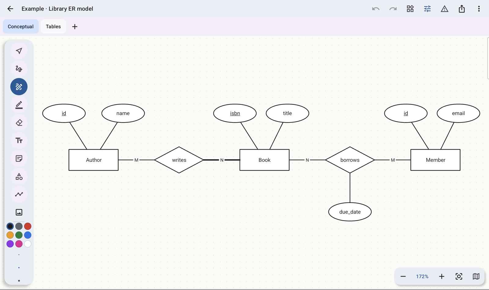 | 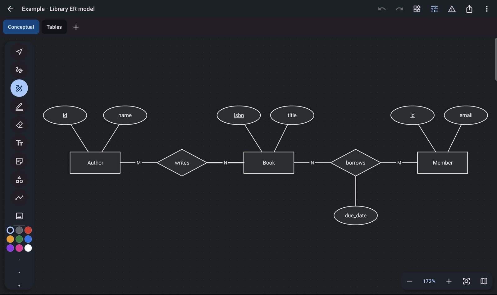 |
| Tables | 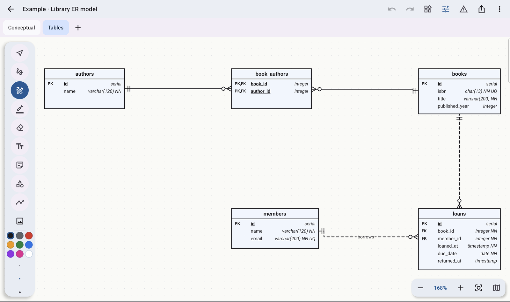 | 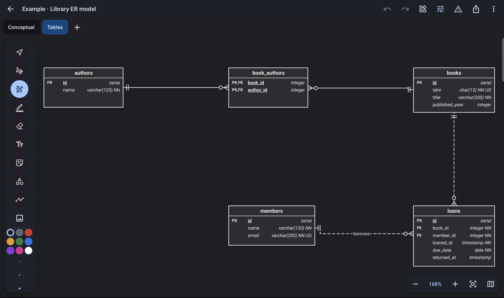 |
| Export | 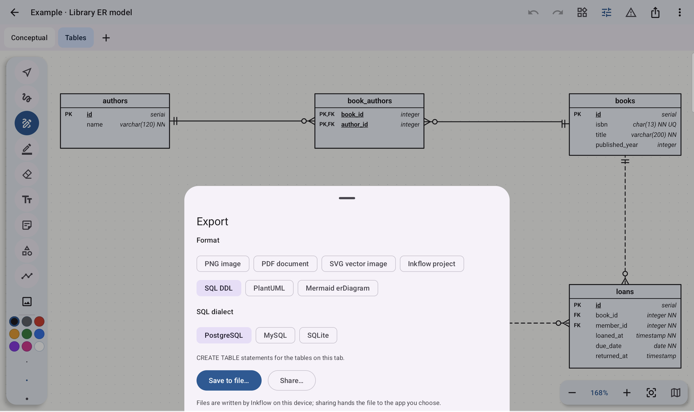 | 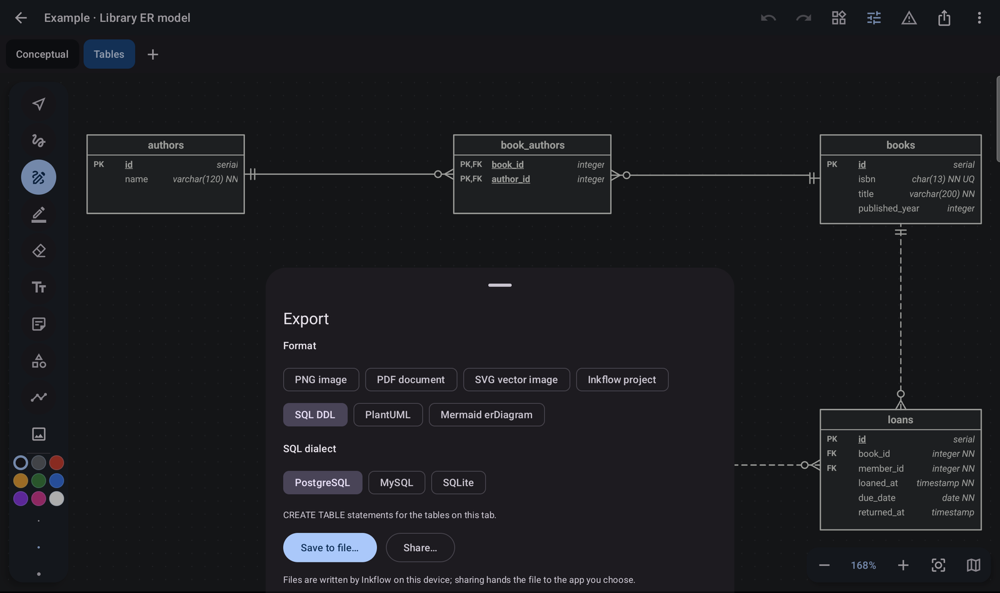 |

To get SQL from the *Tables* tab, choose **Export → SQL DDL**, then pick a dialect. The
PostgreSQL output below was exported on the tablet and runs unchanged on PostgreSQL 18; the
SQLite file runs on SQLite with foreign keys enforced:

```sql
-- Generated by Inkflow (PostgreSQL)

CREATE TABLE "authors" (
  "id" SERIAL PRIMARY KEY,
  "name" VARCHAR(120) NOT NULL
);

CREATE TABLE "books" (
  "id" SERIAL PRIMARY KEY,
  "isbn" CHAR(13) NOT NULL UNIQUE,
  "title" VARCHAR(200) NOT NULL,
  "published_year" INTEGER
);

CREATE TABLE "book_authors" (
  "book_id" INTEGER,
  "author_id" INTEGER,
  PRIMARY KEY ("book_id", "author_id"),
  FOREIGN KEY ("book_id") REFERENCES "books" ("id"),
  FOREIGN KEY ("author_id") REFERENCES "authors" ("id")
);

CREATE TABLE "members" (
  "id" SERIAL PRIMARY KEY,
  "name" VARCHAR(120) NOT NULL,
  "email" VARCHAR(200) NOT NULL UNIQUE
);

CREATE TABLE "loans" (
  "id" SERIAL PRIMARY KEY,
  "book_id" INTEGER NOT NULL,
  "member_id" INTEGER NOT NULL,
  "loaned_at" TIMESTAMP NOT NULL DEFAULT CURRENT_TIMESTAMP,
  "due_date" DATE NOT NULL,
  "returned_at" TIMESTAMP,
  FOREIGN KEY ("book_id") REFERENCES "books" ("id"),
  FOREIGN KEY ("member_id") REFERENCES "members" ("id")
);
CREATE INDEX "loans_member_idx" ON "loans" ("member_id");
```

Tables are ordered so that referenced tables come first. The same tab also exports as a Mermaid
`erDiagram`, which GitHub renders directly:

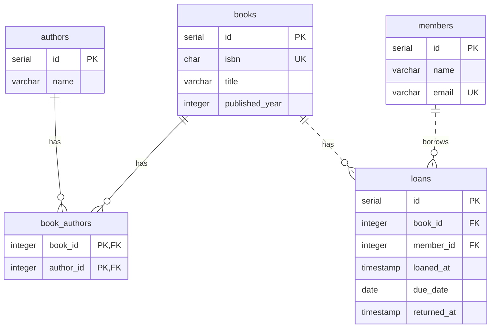

The SQL generator works on Crow's Foot tables. A Chen diagram documents the conceptual model, and
the *Tables* tab is where it becomes a schema.

See [`examples/README.md`](examples/README.md) for every exported file and for how to open the
project in the app.

## More screenshots

| | Light | Dark |
|---|---|---|
| Flowchart | 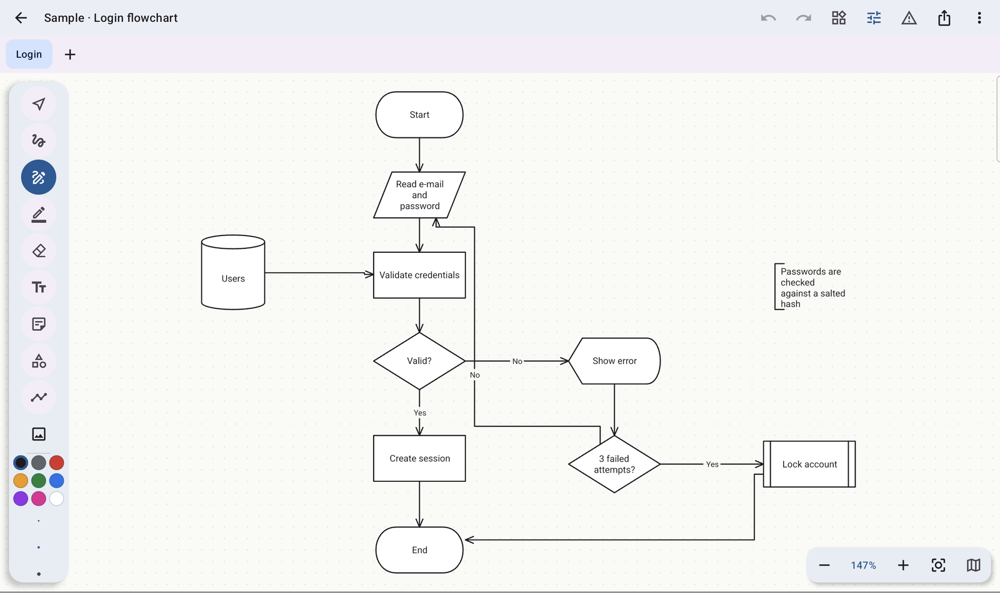 | 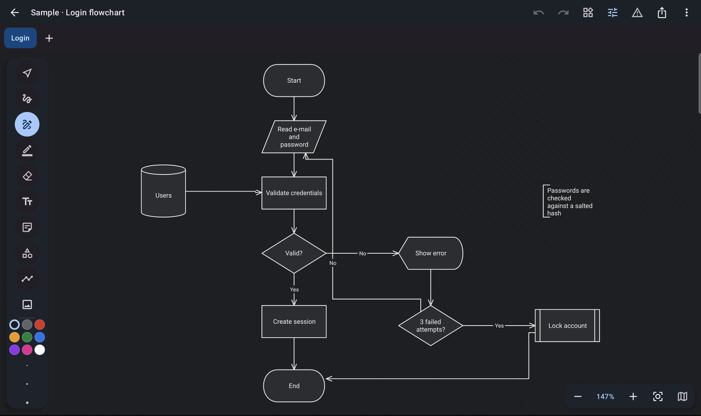 |
| Shape palette | 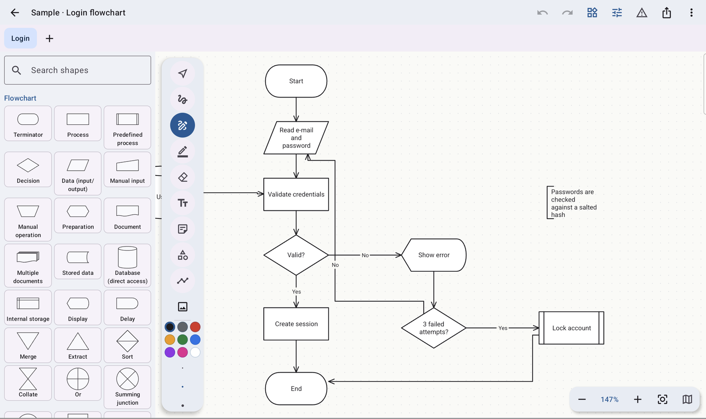 | 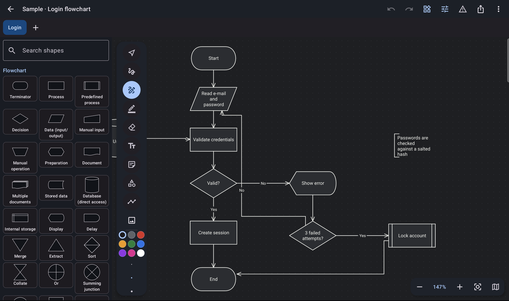 |
| UML classes | 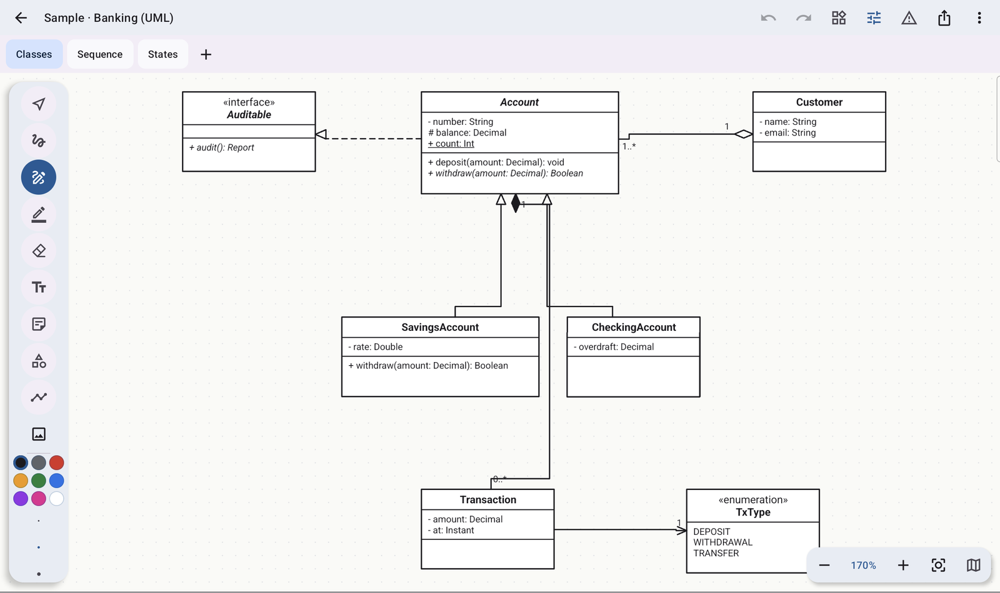 | 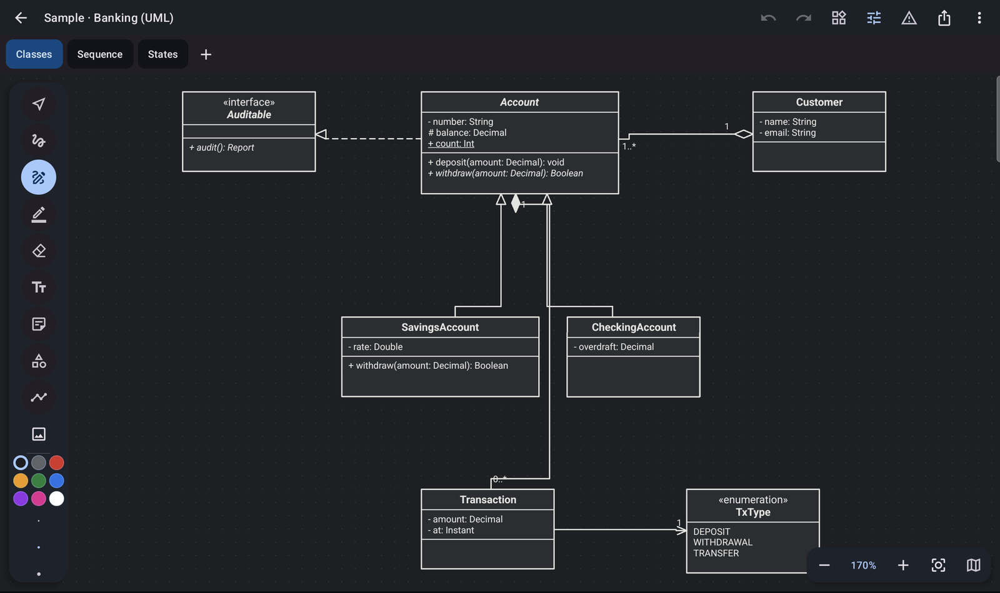 |

All screenshots were taken on a Galaxy Tab S9 FE+.

## Building

Requirements: JDK 17 or newer and the Android SDK (compile SDK 37). Gradle is provided by the
wrapper.

```sh
./gradlew :app:assembleDebug        # APK in app/build/outputs/apk/debug/
./gradlew :app:installDebug         # install on a connected device
./gradlew spotlessApply check       # format, detekt, lint and unit tests
```

Debug builds can fill the gallery with sample projects:

```sh
adb shell am start -n io.github.leonardosponton.inkflow/.MainActivity --es seed all
# or one of: flowchart | uml | db | library | shapes | stress (5 000 elements)
```

To keep your own projects untouched, add `-Pinkflow.appIdSuffix=.demo` to the Gradle command. It
installs a second copy of the app next to the regular one, which is useful for demos and
screenshots.

Instrumented tests need a device or emulator:

```sh
./gradlew :data:repository:connectedDebugAndroidTest
```

These cover the archive round trip, running the generated DDL on SQLite, and the Room schema.

## Architecture

The app uses Kotlin, Jetpack Compose and Material 3, with Hilt, Room, DataStore and Jetpack Ink.
It is split into modules by layer:

| Module | Contents |
|---|---|
| `core:*` | Model, geometry (Double world coordinates), design system, test helpers |
| `domain:canvas` | Scene, commands with invertible changes (undo/redo), gestures, hit testing, routing |
| `domain:diagram` | Data-driven shape and marker registry |
| `domain:flowchart`, `domain:uml`, `domain:dbmodel` | Notations, validators, PlantUML / Mermaid / DDL generation and DDL import |
| `domain:project`, `domain:export` | Project use cases, export options |
| `data:*` | Room database, `.inkflow` archive, repositories |
| `feature:canvas-render` | `InkCanvasView`: tiled `RenderNode` cache, level of detail, ink wet layer |
| `feature:editor`, `feature:home`, `feature:settings`, `feature:export` | Compose screens |
| `benchmark` | Macrobenchmarks and the baseline profile generator |

Design decisions are recorded in [`docs/decisions/`](docs/decisions). Performance measurements
taken on real hardware are in [`docs/device-notes.md`](docs/device-notes.md).

## Status

Version 0.1.0, a personal project. Things still to note:

- Some S Pen side-button gestures have not been confirmed with a physical button press yet.
- Layers exist in the data model, but there is no UI to manage them.
- Release builds are signed with the debug key, because no release keystore is included.

## License

[MIT](LICENSE) © 2026 Leonardo Sponton
